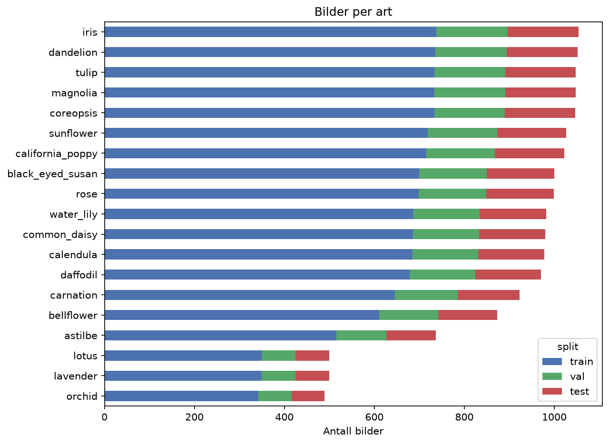
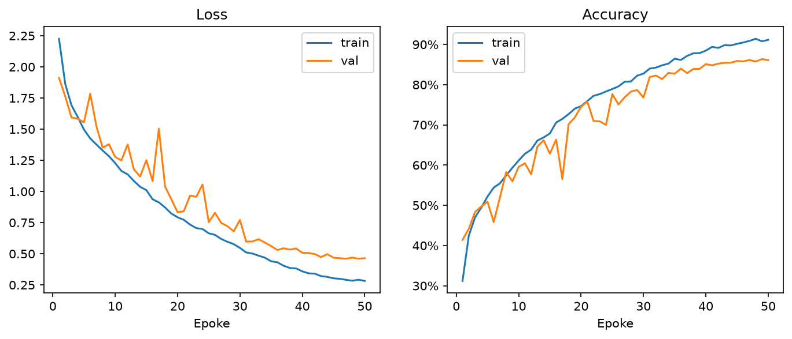

# BloMLster

**Gjenkjenning av blomster med maskinlæring**

Antonio og Vegard Engum, 27. oktober 2026

## Sammendrag

BloMLster er et prosjekt der vi utvikler en bildeklassifiserer som gjenkjenner 19 blomsterarter ut fra et vanlig fotografi. Vi har bygget en komplett datapipeline for et datasett på 17 229 bilder med stratifisert deling i trenings-, validerings- og testsett, og trent et konvolusjonsnettverk (*FlowerNet*) fra bunnen. Modellen oppnår **66,3 % accuracy på testsettet**, mot 5,3 % for tilfeldig gjetting. Resultatet viser at oppgaven er lærbar, men ligger under vårt mål på 90 %. Treningskurvene tyder på at modellen er for liten og ikke har trent lenge nok (underfitting), snarere enn at den overtilpasser. Neste steg er derfor transfer learning med forhåndstrente modeller. Rapporten følger maskinlæringsprosjektets livssyklus: problembeskrivelse, data, modellering og deployment.

## 1: Beskriv problemet

### Omfang

**Mål.** Målet er å utvikle en løsning som automatisk gjenkjenner blomsterarter fra et bilde. Brukeren tar et bilde av en blomst, og systemet returnerer de mest sannsynlige artene sammen med en sikkerhetsscore.

**Hvorfor maskinlæring?** Samme art varierer mye i farge, form, lys, vinkel og bakgrunn, mens ulike arter kan se svært like ut. Det er i praksis umulig å skrive faste regler som fungerer robust (for eksempel «gule kronblader rundt en mørk kjerne = svartøyd Susan»). Konvolusjonsnettverk lærer i stedet relevante visuelle trekk direkte fra merkede eksempler og er en etablert metode for finkornet bildeklassifisering.

**Hvordan løses problemet i dag?** Manuelt bestemmes blomster med floraer, bestemmelsesnøkler eller ved å spørre en kyndig person, noe som krever kunnskap og tid. Det finnes også ferdige apper som Pl@ntNet, iNaturalist og Google Lens. Vår løsning skal ikke konkurrere med disse i skala, men demonstrere hvordan en slik tjeneste kan bygges og evalueres gjennom hele maskinlæringens livssyklus, her avgrenset til 19 vanlige arter.

**Målgruppe og behov.** Produktet er til for turgåere og naturinteresserte som vil lære navnet på blomstene de møter, elever og studenter i biologi og naturfag, og hobbygartnere som vil identifisere planter i hagen. Behovet er rask, enkel og tilgjengelig artsidentifikasjon uten forkunnskaper.

**Systemkomponenter.** Løsningen består av flere deler som påvirker hverandre:

1. Brukergrensesnitt der et bilde lastes opp.

2. Forbehandling (skalering til 224×224 piksler og normalisering).

3. Klassifiseringsmodell som gir en sannsynlighet per art.

4. Etterbehandling som viser de tre mest sannsynlige artene og en melding når modellen er usikker.

Endringer i én del påvirker de andre: endrer vi bildestørrelsen i forbehandlingen, må modellen trenes på nytt, og legger vi til nye arter, påvirkes både modell, klasseliste og grensesnitt. Derfor lagrer vi klassenavn, normaliseringsverdier og bildestørrelse sammen med modellvektene.

**Business objective.** Selv om dette er et kursprosjekt, kan vi definere en tenkt verdi: å spare tid ved artsbestemmelse og øke interessen for og kunnskapen om naturen. En mulig forretningsmodell er en gratis app med utvidede funksjoner (plantedagbok, informasjon om giftighet og pollinatorvennlighet) eller samarbeid med skoler. Verdien kan måles gjennom antall aktive brukere, andel som bruker utvidede funksjoner og brukertilfredshet.

**Ressurser.** Prosjektet gjennomføres av to studenter. Trening skjer lokalt på en PC med AMD Radeon RX 9070 XT-skjermkort via ROCm, med Python, PyTorch/torchvision, scikit-learn, pandas og Jupyter. Modellen er liten nok til at inferens kan kjøres på vanlig CPU.

### Metrikker

**Maskinlæringsmetrikker.**

- *Accuracy* (andel riktig klassifiserte bilder) som hovedmål. Klassene er moderat skjevfordelte (489 til 1 054 bilder per art), så vi supplerer med *macro-F1*.

- *Top-3/top-5 accuracy*: er riktig art blant de mest sannsynlige? Relevant fordi brukeren i praksis ser en liste med forslag.

- *Presisjon og recall per art* og *forvirringsmatrise* for å se hvilke arter som blandes sammen.

- *Kalibrering*: samsvarer konfidensen med faktisk treffsikkerhet? Viktig for å kunne varsle når modellen er usikker.

**Software-metrikker.** *Latency* (tid fra bilde til svar, mål under 2 sekunder), *modellstørrelse* og *throughput* (forespørsler per sekund).

**Sammenheng med business objective.** Høy top-3-treffsikkerhet og lav latency gir en opplevelse av at appen er nyttig og rask, noe som påvirker brukertilfredshet og gjenbruk.

**Minimumskrav for suksess.** Accuracy på testsettet på minst 90 %, top-5 accuracy på minst 97 %, svartid under 2 sekunder og en brukertest der minst 80 % opplever at appen gir nyttige forslag. Dagens modell (66,3 %) oppfyller ikke accuracy-kravet, se kapittel 3.

## 2: Data

**Datatype og kilde.** Dataene er RGB-bilder (JPG/PNG) av blomster, lagret med én mappe per art. Mappenavnet fungerer som label. Datasettet har **19 arter og 17 229 bilder** (kilde: `[legg inn kilde/lenke og lisens for datasettet]`). Artene er astilbe, bellflower, black-eyed susan, calendula, california poppy, carnation, common daisy, coreopsis, daffodil, dandelion, iris, lavender, lotus, magnolia, orchid, rose, sunflower, tulip og water lily.

*Figur 1: Antall bilder per art. Lavender, lotus og orchid har klart færre bilder enn de øvrige.*

**Datamengde.** Med i snitt rundt 900 bilder per art er datamengden tilstrekkelig til å trene en liten CNN fra bunnen og rikelig for transfer learning. Fordelingen er moderat skjev: største art (iris, 1 054 bilder) har drøyt dobbelt så mange bilder som minste (orchid, 489). Det gjør at accuracy alene kan skjule svak ytelse på de små klassene, og vi følger derfor også macro-F1 og resultater per art.

**Labels.** Dette er et *supervised learning*-problem der labels følger med datasettet via mappestrukturen. Vi har ikke kontrollert alle labels manuelt. For å vurdere konsistens sjekker vi et tilfeldig utvalg på `[N]` bilder per art visuelt og noterer andelen feilmerkede eller uklare bilder: `[resultat]`. Bilder med flere arter eller uten synlig blomst bør fjernes.

**Oppdeling av data.** Vi har delt datasettet 70/15/15 med stratifisering på art (fast *random_state* 42), slik at alle arter er representert med samme andel i alle sett. Delingen er lagret i en fil (*labels.csv*), slik at alle eksperimenter bruker nøyaktig samme sett. Testsettet brukes bare til endelig evaluering.

| **Sett**   | **Antall bilder** | **Andel** |
|------------|-------------------|-----------|
| Trening    | 12 060            | 70 %      |
| Validering | 2 584             | 15 %      |
| Test       | 2 585             | 15 %      |

*Tabell 1: Oppdeling av datasettet.*

En svakhet ved tilfeldig deling er at nær-duplikater (for eksempel flere bilder av samme blomst eller samme serie) kan havne i både trenings- og testsett og gi for optimistiske resultater. Vi har ikke undersøkt dette og regner det som en mulig feilkilde.

**Personvern og etikk.**

- Åpne datasett av planter har få personvernutfordringer. Vi dokumenterer kilde og lisens, og eventuelle egne bilder skal ikke inneholde gjenkjennelige personer.

- Bilder lastet opp av brukere kan inneholde metadata som GPS-posisjon. I en driftssatt løsning fjerner vi EXIF-data og lagrer ikke bilder uten samtykke.

- Datasettet dekker bare 19 arter og er trolig geografisk skjevt. Modellen vil alltid foreslå en av de 19 artene, også når bildet viser noe annet. Dette må kommuniseres, og en konfidensterskel bør brukes.

- Feilidentifikasjon av giftige planter kan være farlig. Appen skal tydelig informere om at den ikke skal brukes til å avgjøre om noe er spiselig eller trygt.

**Representasjon og forbehandling.** Bildene leses med PIL (torchvision-versjonen for AMD/ROCm mangler JPEG-støtte), konverteres til RGB og normaliseres med ImageNets gjennomsnitt og standardavvik, slik at inputen også passer forhåndstrente modeller.

- *Trening:* tilfeldig beskjæring (*RandomResizedCrop*, 224×224, 70–100 % av bildet) og tilfeldig horisontal speiling. Dette er *data augmentation* som motvirker overtilpasning.

- *Validering og test:* skalering til 256 piksler og midtbeskjæring til 224×224, uten tilfeldighet.

- Vi bruker batch-størrelse 64. Siden CNN-en lærer egne features fra pikslene, trenger vi ingen manuell feature engineering.

## 3: Modellering

### Baseline

For å vite hva som er en god ytelse har vi to enkle baselines som kan regnes ut direkte:

- **Tilfeldig gjetting:** 1/19 ≈ 5,3 % accuracy.

- **Alltid velge største klasse** (iris): 1 054/17 229 ≈ 6,1 % accuracy.

*Human level performance* er ikke målt ennå. Vi planlegger å la `[3–5]` personer klassifisere et utvalg av testbildene: `[resultat]`. Publiserte resultater på lignende blomsterdatasett, der forhåndstrente CNN-er ofte oppnår over 90 %, gir en rimelig målsetning for videre arbeid.

### Modell: FlowerNet

Vi har trent en enkel CNN fra bunnen, *FlowerNet*, med fire konvolusjonsblokker. Hver blokk består av en 3×3-konvolusjon, batch-normalisering, ReLU og max-pooling, med 32, 64, 128 og 256 filtre. Deretter følger global gjennomsnitts-pooling, dropout (0,3) og et lineært lag med 19 utganger. Modellen har ca. 0,39 millioner parametere. Vi bruker cross-entropy som tapsfunksjon og AdamW (læringsrate 10⁻³, weight decay 10⁻⁴), og trener i 15 epoker med batch-størrelse 64 på GPU.

*Figur 2: Tap og accuracy per epoke for trening og validering.*

### Resultater

| **Modell**                      | **Trening**                     | **Validering**                  | **Test**                        | **Størrelse**                   |
|---------------------------------|---------------------------------|---------------------------------|---------------------------------|---------------------------------|
| Tilfeldig gjetting              | 5,3 %                           | 5,3 %                           | 5,3 %                           | \-                              |
| Majoritetsklasse (iris)         | \-                              | \-                              | ≈ 6,1 %                         | \-                              |
| **FlowerNet (fra bunnen)**      | 70,8 %                          | 67,6 %                          | **66,3 %**                      | ca. 1,6 MB                      |
| MobileNetV2 (transfer learning) | `[ ]` | `[ ]` | `[ ]` | `[ ]` |
| ResNet50 (transfer learning)    | `[ ]` | `[ ]` | `[ ]` | `[ ]` |

*Tabell 2: Accuracy for baselines og modeller. Treningsverdier er fra siste epoke. Modellstørrelse er beregnet for 32-bits vekter.*

**Tolkning.** Accuracy økte jevnt fra 47 % etter første epoke til 71,1 % på validering i epoke 14, men falt til 67,6 % i epoke 15, så valideringskurven er noe urolig. Testsettet ga 66,3 %. Med 2 585 testbilder er usikkerheten på dette tallet omtrent ±1 prosentpoeng, så forskjellen mellom validering og test ligger innenfor tilfeldig variasjon. Modellen er klart bedre enn begge baselines (rundt ti ganger så god), men under målet på 90 %.

Treningsaccuracy (70,8 %) ligger bare litt over valideringsaccuracy, og tapet falt fortsatt da treningen stoppet. Det tyder på **underfitting** og ikke overfitting: modellen er liten, har trent kort, og augmentation og dropout gjør treningen vanskeligere. Mer regularisering vil derfor neppe hjelpe. Større kapasitet, lengre trening og forhåndstrente features er mer lovende.

Vi lagret modellen etter siste epoke, ikke etter epoken med best valideringsresultat. Dette bør endres (lagre beste sjekkpunkt på valideringssettet).

### Feilanalyse

Feilanalyse er ikke gjennomført ennå. Vi planlegger følgende, og funnene fylles inn her: `[resultater]`.

- *Forvirringsmatrise og recall per art* på testsettet. Vi forventer at arter med lignende gul/oransje, tallerkenformet blomst (for eksempel calendula, coreopsis, black-eyed susan, sunflower og dandelion) forveksles oftest. Dette er en hypotese som må bekreftes.

- *Gjennomgang av feilklassifiserte bilder* for å se etter mønstre som dårlig lys, liten blomst i bildet eller rotete bakgrunn.

- *Grad-CAM* for å se om modellen ser på blomsten og ikke bakgrunnen (gress, himmel).

- Funnene brukes til å velge tiltak: mer eller annen augmentation, flere bilder av problemklasser eller bedre beskjæring.

### Videre modellering

1. Transfer learning med MobileNetV2 og ResNet50 forhåndstrent på ImageNet: først trene bare klassifikasjonshodet, deretter *fine-tune* de siste blokkene med lav læringsrate.

2. Læringsrateplan, lengre trening og lagring av beste sjekkpunkt.

3. Måle top-3/top-5 accuracy, macro-F1, kalibrering og latency, slik at alle metrikker fra kapittel 1 rapporteres.

4. Velge endelig modell ut fra balansen mellom treffsikkerhet og størrelse/latency, og evaluere den én gang på testsettet.

## 4: Deployment

**Status.** Den trente modellen er lagret i filen *flowernet.pt* sammen med klassenavn, normaliseringsverdier, bildestørrelse og testaccuracy. Det gjør at et driftssystem kan bruke nøyaktig samme forbehandling som under evaluering.

**Planlagt løsning.** Modellen pakkes inn i en enkel webapplikasjon laget med `[Streamlit/Gradio]`, hostet på `[Hugging Face Spaces/Streamlit Cloud]`. Brukeren laster opp eller tar et bilde, bildet forbehandles med samme valideringstransformasjon (skalering til 256, midtbeskjæring til 224, normalisering), og appen viser de tre mest sannsynlige artene med sikkerhetsscore. Ligger høyeste konfidens under en terskel (for eksempel 50 %), vises meldingen «Usikker, prøv et nytt bilde». Lenke og skjermbilder: `[settes inn]`.

**Bruk av prediksjoner.** Prediksjonene er veiledende forslag, ikke fasit. Appen viser eksempelbilder av de foreslåtte artene slik at brukeren kan sammenligne selv, og har en tydelig advarsel om at den ikke skal brukes til å avgjøre om en plante er spiselig.

**Monitorering og vedlikehold.**

- Logge latency, feilrater og antall forespørsler.

- Overvåke *data drift*: avviker brukernes bilder fra treningsdata (andre arter, annen kvalitet)? Følge fordelingen av konfidensscorer over tid, siden fallende konfidens kan tyde på drift.

- La brukere svare på «var dette riktig?» og bruke tilbakemeldingene til å samle nye, verifiserte treningsdata.

- Retrene modellen periodisk, og versjonere modellene slik at vi kan rulle tilbake ved feil.

**Videre forbedring.** Utvide til flere arter (særlig norske), legge til objektdeteksjon for bilder med flere blomster, kjøre modellen lokalt på mobil (for eksempel med TensorFlow Lite/ONNX) og utvide med plantefakta som blomstringstid, utbredelse og giftighet.

## 5: Referanser

- Paszke, A., et al. (2019). PyTorch: An imperative style, high-performance deep learning library. *NeurIPS*.

- Pedregosa, F., et al. (2011). Scikit-learn: Machine learning in Python. *Journal of Machine Learning Research, 12*.

- Loshchilov, I., & Hutter, F. (2019). Decoupled weight decay regularization. *ICLR*.

- Ioffe, S., & Szegedy, C. (2015). Batch normalization: Accelerating deep network training by reducing internal covariate shift. *ICML*.

- Srivastava, N., et al. (2014). Dropout: A simple way to prevent neural networks from overfitting. *Journal of Machine Learning Research, 15*.

- He, K., Zhang, X., Ren, S., & Sun, J. (2016). Deep residual learning for image recognition. *CVPR*.

- Sandler, M., et al. (2018). MobileNetV2: Inverted residuals and linear bottlenecks. *CVPR*.

- Deng, J., et al. (2009). ImageNet: A large-scale hierarchical image database. *CVPR*.

- Selvaraju, R. R., et al. (2017). Grad-CAM: Visual explanations from deep networks via gradient-based localization. *ICCV*.

- Pl@ntNet (plantnet.org) og iNaturalist (inaturalist.org): eksisterende løsninger for plantegjenkjenning.

- `[Datasettet: kilde, lenke og lisens]`

- `[Kursmateriale og eventuelle andre kilder]`
