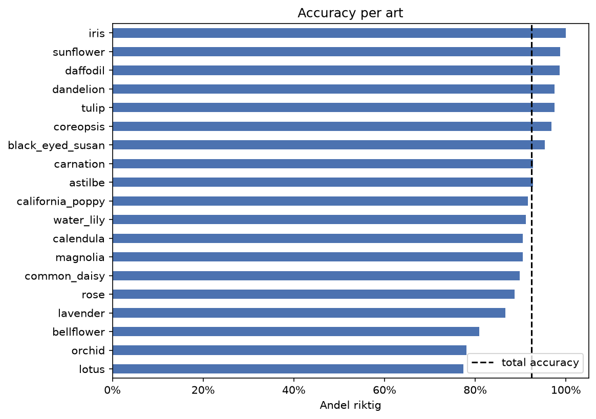
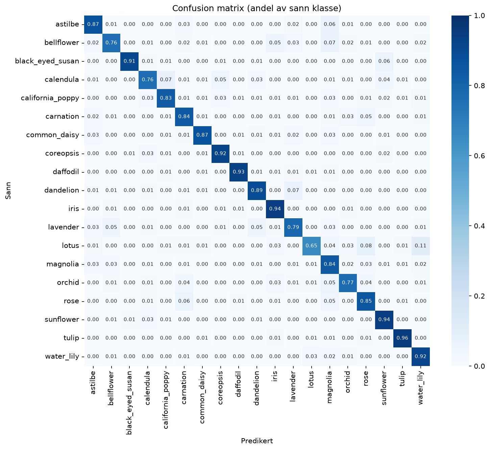
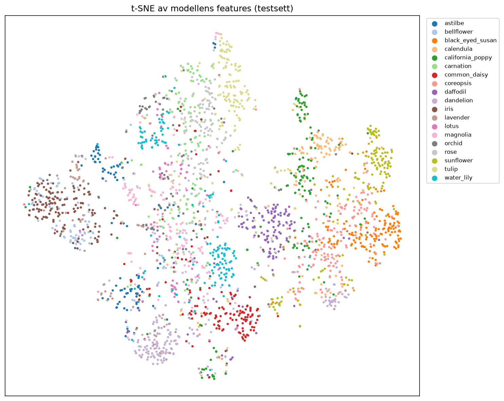
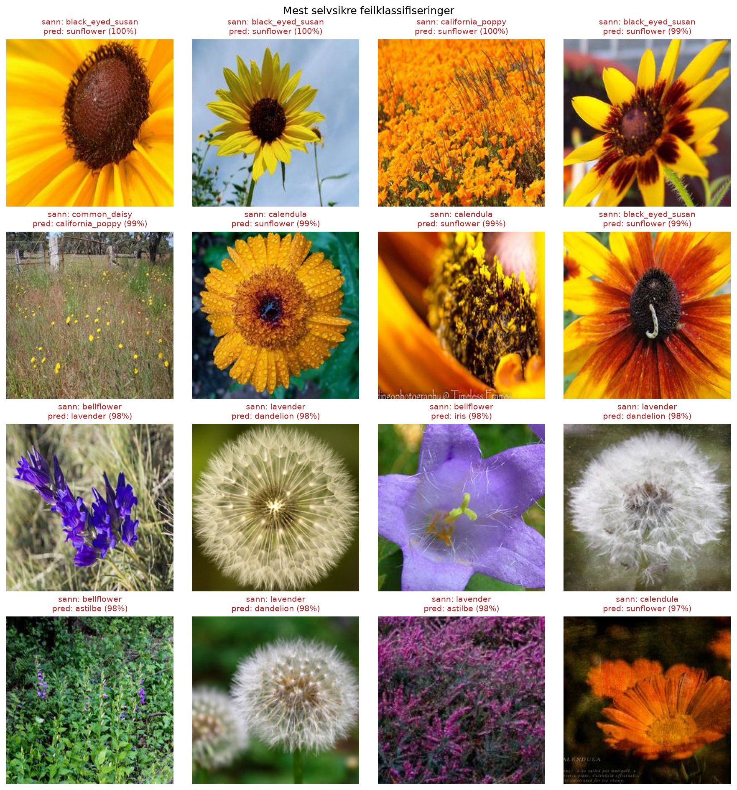
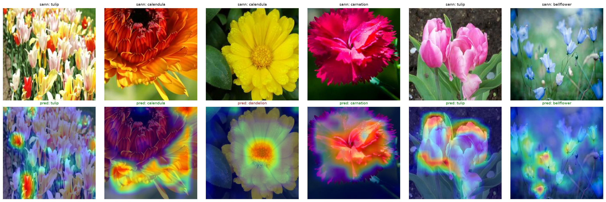
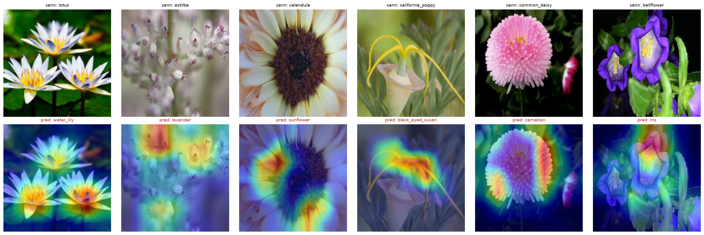
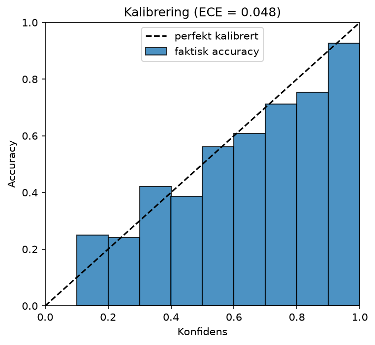
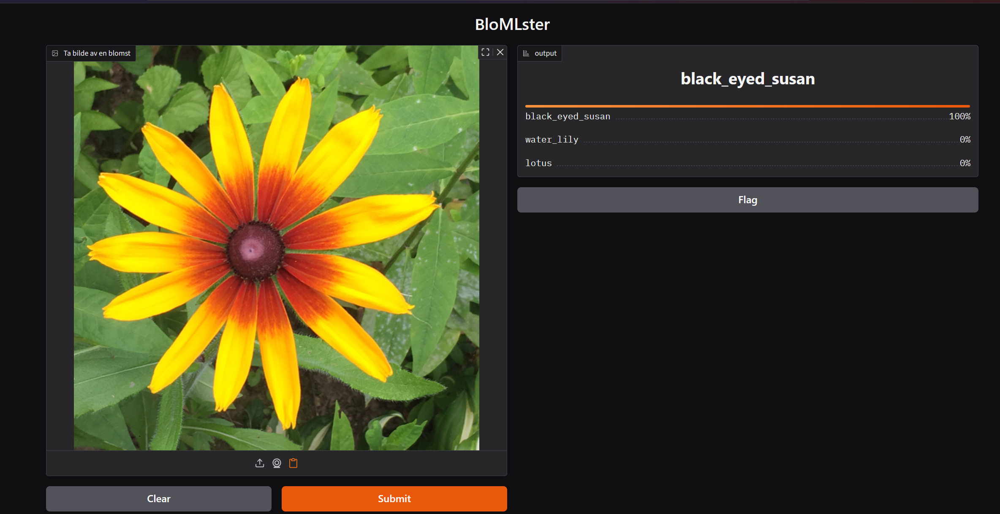

# BloMLster

**Gjenkjenning av blomster med maskinlæring**
Antonio Hammerstad og Vegard Engum

## Sammendrag

BloMLster er en nettapp som gjenkjenner 19 blomsterarter ut fra et vanlig fotografi. Vi har bygget en komplett pipeline for et datasett på 17 229 bilder med stratifisert deling i trenings-, validerings- og testsett, og trent et konvolusjonsnettverk (*FlowerNet*) fra bunnen. Et første forsøk ga 66,3 % accuracy og viste tydelig underfitting. Etter å ha økt modellens kapasitet og trent lenger med læringsrateplan oppnår den endelige modellen **92,3 % accuracy, 91,6 % macro-F1 og 99,1 % top-5 accuracy** på testsettet, mot 5,3 % for tilfeldig gjetting. Feilanalysen viser at de vanligste feilene er forveksling av lotus og vannlilje, at de minste klassene er svakest, og at flere av modellens «feil» egentlig er feilmerkede bilder i datasettet. Modellen er gjort tilgjengelig i en webapp laget med Gradio. Rapporten følger maskinlæringsprosjektets livssyklus: problembeskrivelse, data, modellering og deployment.

## 1: Beskriv problemet

### Omfang

**Mål.** Målet er å utvikle en løsning som automatisk gjenkjenner blomsterarter fra et bilde. Brukeren tar eller laster opp et bilde av en blomst, og systemet returnerer de mest sannsynlige artene sammen med en sikkerhetsscore.

**Hvorfor maskinlæring?** Samme art varierer mye i farge, form, lys, vinkel og bakgrunn, mens ulike arter kan se svært like ut. Det er i praksis umulig å skrive faste regler som fungerer robust (for eksempel «gule kronblader rundt en mørk kjerne = svartøyd Susan»). Konvolusjonsnettverk lærer i stedet relevante visuelle trekk direkte fra merkede eksempler og er en etablert metode for finkornet bildeklassifisering.

**Hvordan løses problemet i dag?** Manuelt bestemmes blomster med floraer, bestemmelsesnøkler eller ved å spørre en kyndig person, noe som krever kunnskap og tid. Det finnes også ferdige apper som Pl@ntNet, iNaturalist og Google Lens. Vår løsning skal ikke konkurrere med disse i skala, men demonstrere hvordan en slik tjeneste kan bygges og evalueres gjennom hele maskinlæringens livssyklus, her avgrenset til 19 vanlige arter.

**Målgruppe og behov.** Utgangspunktet for prosjektet var en konkret bruker: en bestemor som er glad i blomster, men som synes teknologi er vanskelig. Hun skal kunne åpne en nettside på mobilen, ta bilde av en blomst i huset eller hagen og få vite hva den heter. Det stiller krav om et svært enkelt grensesnitt med én knapp og et tydelig svar. Det samme behovet finnes hos turgåere og naturinteresserte, elever og studenter i biologi og naturfag, og hobbygartnere: rask og enkel artsidentifikasjon uten forkunnskaper. Brukerhistorien peker også på en begrensning. Bilder av stueplanter tatt med mobilkamera kan se annerledes ut enn bildene modellen er trent på (se kapittel 2).

**Systemkomponenter.** Løsningen består av flere deler som påvirker hverandre:

1. Brukergrensesnitt der et bilde tas eller lastes opp.

2. Forbehandling (skalering og midtbeskjæring til 224×224 piksler, normalisering).

3. Klassifiseringsmodell som gir en sannsynlighet per art.

4. Etterbehandling som viser de tre mest sannsynlige artene med sikkerhetsscore.

Endringer i én del påvirker de andre: endrer vi bildestørrelsen i forbehandlingen, må modellen trenes på nytt, og legger vi til nye arter, påvirkes både modell, klasseliste og grensesnitt. Derfor lagrer vi klassenavn, normaliseringsverdier og bildestørrelse sammen med modellvektene.

**Business objective.** Selv om dette er et kursprosjekt, kan vi definere en tenkt verdi: å spare tid ved artsbestemmelse og øke interessen for og kunnskapen om naturen. En mulig forretningsmodell er en gratis app med utvidede funksjoner (plantedagbok, informasjon om giftighet og pollinatorvennlighet) eller samarbeid med skoler. Verdien kan måles gjennom antall aktive brukere, andel som bruker utvidede funksjoner og brukertilfredshet.

**Ressurser.** Prosjektet gjennomføres av to studenter. Trening skjer lokalt på en PC med AMD Radeon RX 9070 XT-skjermkort via ROCm, med Python, PyTorch/torchvision, scikit-learn, pandas og Jupyter. Modellen er liten nok til at inferens kan kjøres på vanlig CPU.

### Metrikker

**Maskinlæringsmetrikker.**

- *Accuracy* (andel riktig klassifiserte bilder) som hovedmål. Klassene er moderat skjevfordelte (489 til 1 054 bilder per art), så vi supplerer med *macro-F1*.

- *Top-3/top-5 accuracy*: er riktig art blant de mest sannsynlige? Relevant fordi brukeren ser en liste med de tre beste forslagene.

- *Presisjon og recall per art* og *forvirringsmatrise* for å se hvilke arter som blandes sammen.

- *Kalibrering*: samsvarer konfidensen med faktisk treffsikkerhet? Viktig for å kunne varsle når modellen er usikker.

**Software-metrikker.** *Latency* (tid fra bilde til svar, mål under 2 sekunder), *modellstørrelse* og *throughput* (forespørsler per sekund).

**Sammenheng med business objective.** Høy top-3-treffsikkerhet og lav latency gir en opplevelse av at appen er nyttig og rask, noe som påvirker brukertilfredshet og gjenbruk.

**Minimumskrav for suksess.** Vi satte følgende krav før modelleringen startet:

| **Krav**                                    | **Mål**  | **Oppnådd**                   | **Status** |
|---------------------------------------------|----------|-------------------------------|------------|
| Accuracy på testsettet                      | ≥ 90 %   | 92,3 %                        | ✓          |
| Top-5 accuracy på testsettet                | ≥ 97 %   | 99,1 %                        | ✓          |
| Svartid (modell på CPU)                     | < 2 s    | ca. 40 ms                     | ✓          |
| Andel i brukertest som opplever nytte       | ≥ 80 %   | ikke gjennomført              | X          |

*Tabell 1: Minimumskrav og status for den endelige modellen.*

## 2: Data

**Datatype og kilde.** Dataene er RGB-bilder (JPG/PNG) av blomster, lagret med én mappe per art. Mappenavnet fungerer som label. Datasettet har **19 arter og 17 229 bilder** og er hentet fra Kaggle (*Flower Classification*, supriyoain), lisens: Apache 2.0. Artene er astilbe, bellflower, black-eyed susan, calendula, california poppy, carnation, common daisy, coreopsis, daffodil, dandelion, iris, lavender, lotus, magnolia, orchid, rose, sunflower, tulip og water lily.

*Figur 1: Antall bilder per art, fordelt på trening, validering og test. Lavender, lotus og orchid har klart færre bilder enn de øvrige.*

**Datamengde.** Med i snitt rundt 900 bilder per art er datamengden tilstrekkelig til å trene en CNN fra bunnen. Fordelingen er moderat skjev: største art (iris, 1 054 bilder) har drøyt dobbelt så mange bilder som minste (orchid, 489). Det gjør at accuracy alene kan skjule svak ytelse på de små klassene, og vi følger derfor også macro-F1 og resultater per art.

**Labels.** Dette er et *supervised learning*-problem der labels følger med datasettet via mappestrukturen. Vi har ikke kontrollert alle labels manuelt. Feilanalysen i kapittel 3 viser at datasettet inneholder feilmerkede bilder: blant modellens mest selvsikre feil finnes for eksempel en tydelig iris merket som bellflower.

**Oppdeling av data.** Vi har delt datasettet 70/15/15 med stratifisering på art (fast *random_state* 42), slik at alle arter er representert med samme andel i alle sett. Delingen er lagret i en fil (*labels.csv*), slik at alle eksperimenter bruker nøyaktig samme sett. Valg av modell og hyperparametere er gjort på valideringssettet.

| **Sett**   | **Antall bilder** | **Andel** |
|------------|-------------------|-----------|
| Trening    | 12 060            | 70 %      |
| Validering | 2 584             | 15 %      |
| Test       | 2 585             | 15 %      |

*Tabell 2: Oppdeling av datasettet.*

En svakhet ved tilfeldig deling er at nær-duplikater (for eksempel flere bilder av samme blomst eller samme serie) kan havne i både trenings- og testsett og gi for optimistiske resultater. Vi har ikke undersøkt dette og regner det som en mulig feilkilde. Mange av bildene ser også ut til å være redigerte eller profesjonelle fotografier med blomsten midt i bildet, mens brukernes mobilbilder ofte er mindre perfekte. Testresultatet sier derfor mest om bilder som ligner datasettet.

**Personvern og etikk.**

- Åpne datasett av planter har få personvernutfordringer. Vi har oppgitt kilden til datasettet, og eventuelle egne bilder skal ikke inneholde gjenkjennelige personer.

- Bilder lastet opp av brukere kan inneholde metadata som GPS-posisjon. Appen lagrer i dag ikke bilder automatisk, men Gradio har en innebygd «Flag»-knapp som lagrer bildet brukeren har lastet opp. Den bør enten skrus av eller bare brukes med samtykke. I en driftssatt løsning bør EXIF-data fjernes før eventuell lagring.

- Datasettet dekker bare 19 arter og er trolig geografisk skjevt. Modellen vil alltid foreslå en av de 19 artene, også når bildet viser noe annet. Dette må kommuniseres, og en konfidensterskel bør brukes.

- Feilidentifikasjon av giftige planter kan være farlig. Appen skal ikke brukes til å avgjøre om noe er spiselig eller trygt.

**Representasjon og forbehandling.** Bildene leses med PIL (torchvision-versjonen for AMD/ROCm mangler JPEG-støtte), konverteres til RGB og normaliseres med ImageNets gjennomsnitt og standardavvik. Det gjør det også enkelt å sammenligne med forhåndstrente modeller senere.

- *Trening:* tilfeldig beskjæring (*RandomResizedCrop*, 224×224, 70–100 % av bildet) og tilfeldig horisontal speiling. Dette er *data augmentation* som motvirker overtilpasning.

- *Validering, test og app:* skalering til 256 piksler og midtbeskjæring til 224×224, uten tilfeldighet. Appen bruker nøyaktig samme transformasjon.

- Vi bruker batch-størrelse 64. Siden CNN-en lærer egne features fra pikslene, trenger vi ingen manuell feature engineering.

## 3: Modellering

### Baseline

For å vite hva som er en god ytelse har vi to enkle baselines som kan regnes ut direkte:

- **Tilfeldig gjetting:** 1/19 ≈ 5,3 % accuracy.

- **Alltid velge største klasse** (iris): 158/2 585 ≈ 6,1 % accuracy på testsettet.

### Forsøk 1: FlowerNet v1

Vi startet med en enkel CNN fra bunnen med fire konvolusjonsblokker. Hver blokk besto av én 3×3-konvolusjon, batch-normalisering, ReLU og max-pooling, med 32, 64, 128 og 256 filtre. Deretter fulgte global gjennomsnitts-pooling, dropout (0,3) og et lineært lag med 19 utganger, totalt ca. 0,39 millioner parametere. Vi brukte cross-entropy som tapsfunksjon og AdamW (læringsrate 10⁻³, weight decay 10⁻⁴), og trente i 15 epoker.

Modellen fikk 70,8 % accuracy på trening og 67,6 % på validering i siste epoke. Treningsaccuracy lå bare litt over valideringsaccuracy, og tapet falt fortsatt da treningen stoppet. Det tydet på **underfitting**: modellen var for liten og hadde trent for kort. Mer regularisering ville derfor neppe hjelpe, mens større kapasitet og lengre trening var lovende. Vi lagret dessuten modellen etter siste epoke i stedet for den beste, og valideringskurven var urolig (71,1 % i epoke 14, 67,6 % i epoke 15).

### Forsøk 2: FlowerNet v2 (endelig modell)

Basert på diagnosen gjorde vi tre endringer:

1. **Større kapasitet:** fem blokker med to 3×3-konvolusjoner hver (konvolusjon, batch-normalisering, ReLU, to ganger, og deretter max-pooling), med 32, 64, 128, 256 og 384 filtre. Bildet går fra 224×224 til 7×7 før global gjennomsnitts-pooling, dropout (0,3) og et lineært lag. Modellen har ca. 3,4 millioner parametere (13,6 MB).

2. **Lengre trening med læringsrateplan:** 50 epoker med AdamW (weight decay 10⁻⁴) og *OneCycleLR* med maks læringsrate 3·10⁻³. Læringsraten øker først og synker deretter mot null, noe som gir raskere og mer stabil trening. Vi trener med bf16-presisjon på GPU for å spare tid og minne.

3. **Lagring av beste sjekkpunkt:** modellen lagres hver gang accuracy på valideringssettet blir bedre. Beste epoke var epoke 42.

*Figur 2: Tap og accuracy per epoke for trening og validering (FlowerNet v2).*

### Resultater

| **Modell**              | **Trening** | **Validering** | **Test**   | **Macro-F1** | **Top-3** | **Top-5** | **Parametere** | **Størrelse** |
|-------------------------|-------------|----------------|------------|--------------|-----------|-----------|----------------|---------------|
| Tilfeldig gjetting      | 5,3 %       | 5,3 %          | 5,3 %      | -            | 15,8 %    | 26,3 %    | -              | -             |
| Majoritetsklasse (iris) | -           | -              | 6,1 %      | -            | -         | -         | -              | -             |
| FlowerNet v1            | 70,8 %      | 67,6 %         | 66,3 %     | -            | -         | -         | 0,39 M         | 1,6 MB        |
| **FlowerNet v2**        | 99,3 %      | 91,8 %         | **92,3 %** | 91,6 %       | 97,9 %    | 99,1 %    | 3,4 M          | 13,6 MB       |

*Tabell 3: Resultater for baselines og modeller. For v1 er verdiene fra siste epoke, for v2 fra beste epoke (42). Test accuracy for v2 er 92,3 % målt med bf16 under trening og 92,4 % med full presisjon i evalueringsnotebooken. Macro-F1 og top-k er målt i evalueringsnotebooken. Modellstørrelse er beregnet for 32-bits vekter.*

**Tolkning.** Accuracy på validering steg raskt de første 20 epokene og flatet ut rundt 91,8 % fra epoke 40, mens læringsraten gikk mot null (figur 2). Testsettet ga 92,3 %. Med 2 585 testbilder er usikkerheten på dette tallet omtrent ±1 prosentpoeng (95 % konfidensintervall), så validering og test stemmer godt overens. Modellen er rundt 17 ganger bedre enn tilfeldig gjetting og oppfyller både accuracy-kravet (90 %) og top-5-kravet (97 %).

Treningsaccuracy når over 99 %, mens validering stopper på 91,8 %. Gapet på rundt 7,5 prosentpoeng betyr at modellen nå **overtilpasser noe**, det motsatte av problemet i forsøk 1. Valideringstapet stiger likevel ikke mot slutten, så overtilpasningen er moderat, og lagringen av beste sjekkpunkt sikrer at vi bruker en god versjon. Videre forbedring krever trolig mer eller renere data, sterkere augmentation eller forhåndstrente features, ikke mer kapasitet.

Testsettet ble også brukt til å evaluere v1. Valget av v2 ble likevel gjort ut fra valideringsresultatene, ikke testresultatene.

**Latency.** Én prediksjon (ett bilde på 224×224) tar ca. 40 ms på CPU, målt som snitt over 20 kjøringer på en bærbar PC med AMD Ryzen 7 6800H. Det er godt under kravet på 2 sekunder, også med tid til opplasting og forbehandling.

### Feilanalyse

Alle figurene i dette avsnittet er laget i *02evaluering.ipynb* på testsettet.

*Figur 3: Andel riktig (recall) per art. Stiplet linje viser total accuracy.*

**Ytelse per art.** De svakeste artene er lotus (77 % recall), orchid (78 %) og bellflower (81 %). Lotus og orchid er to av de tre minste klassene, noe som støtter bekymringen fra kapittel 2 om at skjev fordeling går ut over småklassene. Iris (100 %), sunflower (99 %) og daffodil (99 %) er nesten feilfrie.

*Figur 4: Normalisert forvirringsmatrise. Hver rad summerer til 1, og diagonalen er recall per art.*

**Hvilke arter forveksles?** De vanligste forvekslingene er:

| **Sann art**     | **Predikert som** | **Antall** |
|------------------|-------------------|------------|
| lotus            | water lily        | 8          |
| bellflower       | magnolia          | 8          |
| water lily       | lotus             | 7          |
| rose             | carnation         | 6          |
| orchid           | magnolia          | 6          |
| california poppy | calendula         | 5          |
| calendula        | california poppy  | 5          |
| astilbe          | magnolia          | 5          |

*Tabell 4: De vanligste forvekslingene på testsettet.*

Lotus og vannlilje forveksles begge veier. Det er rimelig, fordi begge er vannplanter med lignende kronblader og bakgrunn. Magnolia «trekker til seg» feil fra mange ulike arter og har lavest presisjon av alle (79 %). Før feilanalysen antok vi at gule, tallerkenformede blomster (calendula, coreopsis, black-eyed susan, sunflower, dandelion) ville forveksles mest. **Denne hypotesen ble avkreftet:** fire av de fem har 95–99 % recall, og bare calendula og california poppy forveksles i noen grad.

*Figur 5: t-SNE av modellens 384 features før siste lag, testsettet.*

t-SNE-plottet (figur 5) bekrefter bildet: de fleste arter danner egne, tydelige grupper. Lotus ligger helt inntil vannlilje, og i midten av plottet ligger magnolia omgitt av punkter fra flere andre arter. Det passer med at magnolia ofte blir et «reservesvar».

*Figur 6: De 16 feilene modellen var mest sikker på.*

**Selvsikre feil.** Gjennomgangen av feilene modellen var mest sikker på (figur 6) viser tre mønstre:

- **Feilmerkede bilder:** flere av «feilene» ser ut til å være riktige prediksjoner på bilder med feil label, for eksempel en tydelig iris merket som bellflower. Den reelle feilraten er derfor trolig noe lavere enn 7,7 %.
- **Mange små blomster:** bilder av for eksempel en solsikkeåker, der ingen enkeltblomst dominerer, er vanskelige for modellen.
- **Overkonfidens:** modellen oppgir nær 100 % sikkerhet også når den tar feil.

*Figur 7: Grad-CAM for tilfeldige testbilder (øverst) og feilklassifiserte bilder (nederst). Rødt viser områdene som påvirket prediksjonen mest.*

**Hvor ser modellen?** Grad-CAM (figur 7) viser at modellen i de fleste tilfeller ser på selve blomsten og ikke på bakgrunnen. I noen eksempler ligger fokuset på kantene av kronbladene eller på en liten del av blomsten i stedet for hele, og flere av de feilklassifiserte bildene kan også være feilmerket (for eksempel et bilde merket lotus som ser ut som en vannlilje). I eksemplene vi har sett på, fant vi ingen tegn på at modellen systematisk bruker bakgrunn som gress eller himmel som snarvei.

*Figur 8: Kalibrering (reliability diagram). Søyler under den stiplede linjen betyr at modellen er mer sikker enn den har grunn til.*

**Kalibrering.** Gjennomsnittlig kalibreringsfeil (ECE) er 0,039, som er lavt, trolig fordi de aller fleste prediksjonene har konfidens over 90 % og da stort sett er riktige. For prediksjoner med konfidens mellom 30 og 90 % er modellen derimot systematisk overkonfident: når den sier 60–80 %, har den rett i bare 52–57 % av tilfellene. En terskel for «usikker» i appen bør derfor settes høyere enn den naive verdien, eller modellen bør kalibreres med for eksempel *temperature scaling*.

**Tiltak basert på feilanalysen.**

- Rense labels i datasettet, for eksempel ved å gå gjennom bildene der modellen er svært sikker, men uenig med labelen.
- Styrke småklassene med flere bilder eller vektet tapsfunksjon.
- Kalibrere modellen før vi innfører en konfidensterskel i appen.

### Videre modellering

1. Transfer learning med en forhåndstrent modell (for eksempel MobileNetV2 eller ResNet50 trent på ImageNet), og sammenligne med FlowerNet v2 på accuracy, størrelse og latency.

2. Sterkere augmentation (fargeendringer, rotasjon) for å redusere overtilpasningen.

3. Tiltakene fra feilanalysen over: rensing av labels, vektet tapsfunksjon og kalibrering.

## 4: Deployment

**Løsning.** Modellen er satt i drift som en webapp laget med Gradio (*app.py*). Den trente modellen ligger i filen *flowernet.pt* sammen med klassenavn, normaliseringsverdier, bildestørrelse og test accuracy, slik at appen bruker nøyaktig samme forbehandling som under evaluering. Brukeren laster opp et bilde eller tar et bilde med kameraet. Bildet forbehandles (skalering til 256, midtbeskjæring til 224, normalisering), modellen kjører på CPU, og appen viser de tre mest sannsynlige artene med sikkerhetsscore. Grensesnittet består bare av ett bildefelt og en knapp, slik at det skal være enkelt å bruke også for brukere som ikke er vant med teknologi.

*Figur 9: Skjermbilde av appen.*

Appen startes med `python app.py`. Gradio lager da en midlertidig offentlig lenke (`share=True`). [Se demovideo](https://youtu.be/5u2aSCRADPE)

**Bruk av prediksjoner.** Prediksjonene er veiledende forslag, ikke fasit. Fordi brukeren ser tre forslag, har svaret nytte også når riktig art ikke er førstevalget (top-3 accuracy er 97,9 %).

**Monitorering og vedlikehold.**

- Logge latency, feilrater og antall forespørsler.

- Overvåke *data drift*: avviker brukernes bilder fra treningsdata (andre arter, annen kvalitet)? Følge fordelingen av konfidensscorer over tid, siden fallende konfidens kan tyde på drift.

- La brukere svare på «var dette riktig?» og bruke svarene til å samle nye, verifiserte treningsdata. Gradios innebygde «Flag»-funksjon kan brukes til dette, men bare med samtykke fra brukeren.

- Trene modellen på nytt med jevne mellomrom, og versjonere modellene slik at vi kan rulle tilbake ved feil.

**Videre forbedring.**

- Vise meldingen «Usikker, prøv et nytt bilde» når høyeste konfidens er under en terskel, valgt ut fra kalibreringsanalysen.
- Vise en tydelig advarsel om at appen ikke skal brukes til å avgjøre om en plante er spiselig eller trygg.
- Vise eksempelbilder av de foreslåtte artene, slik at brukeren kan sammenligne selv.
- Utvide til flere arter (særlig vanlige norske arter og stueplanter), legge til objektdeteksjon for bilder med flere blomster, og kjøre modellen lokalt på mobil (for eksempel med ONNX).

## 5: Referanser

- Datasett: supriyoain. *Flower Classification*. Kaggle. https://www.kaggle.com/datasets/supriyoain/flower-classification. Lisens: Apache 2.0.

- PyTorch-dokumentasjonen og -tutorialene, særlig *Learn the Basics* (Datasets & DataLoaders, Build the Neural Network, Optimizing Model Parameters). https://docs.pytorch.org/tutorials/beginner/basics/intro.html. Brukt som utgangspunkt for datasett-klassen og treningsløkken.

- Gradio: Abid, A., et al. (2019). Gradio: Hassle-free sharing and testing of ML models in the wild. *arXiv:1906.02569*.

- Paszke, A., et al. (2019). PyTorch: An imperative style, high-performance deep learning library. *NeurIPS*.

- Pedregosa, F., et al. (2011). Scikit-learn: Machine learning in Python. *Journal of Machine Learning Research, 12*.

- Loshchilov, I., & Hutter, F. (2019). Decoupled weight decay regularization. *ICLR*.

- Smith, L. N., & Topin, N. (2019). Super-convergence: Very fast training of neural networks using large learning rates. *Artificial Intelligence and Machine Learning for Multi-Domain Operations Applications*, SPIE.

- Ioffe, S., & Szegedy, C. (2015). Batch normalization: Accelerating deep network training by reducing internal covariate shift. *ICML*.

- Srivastava, N., et al. (2014). Dropout: A simple way to prevent neural networks from overfitting. *Journal of Machine Learning Research, 15*.

- Deng, J., et al. (2009). ImageNet: A large-scale hierarchical image database. *CVPR*. (Normaliseringsverdier.)

- Selvaraju, R. R., et al. (2017). Grad-CAM: Visual explanations from deep networks via gradient-based localization. *ICCV*.

- van der Maaten, L., & Hinton, G. (2008). Visualizing data using t-SNE. *Journal of Machine Learning Research, 9*.

- Guo, C., et al. (2017). On calibration of modern neural networks. *ICML*. (Kalibrering og temperature scaling.)

- He, K., Zhang, X., Ren, S., & Sun, J. (2016). Deep residual learning for image recognition. *CVPR*. (Videre arbeid.)

- Sandler, M., et al. (2018). MobileNetV2: Inverted residuals and linear bottlenecks. *CVPR*. (Videre arbeid.)

- Pl@ntNet (plantnet.org) og iNaturalist (inaturalist.org): eksisterende løsninger for plantegjenkjenning.

- **Bruk av AI-verktøy:** Claude Code (Anthropic) er brukt til drøfting av strategier, kode og skriving av rapporten. 

